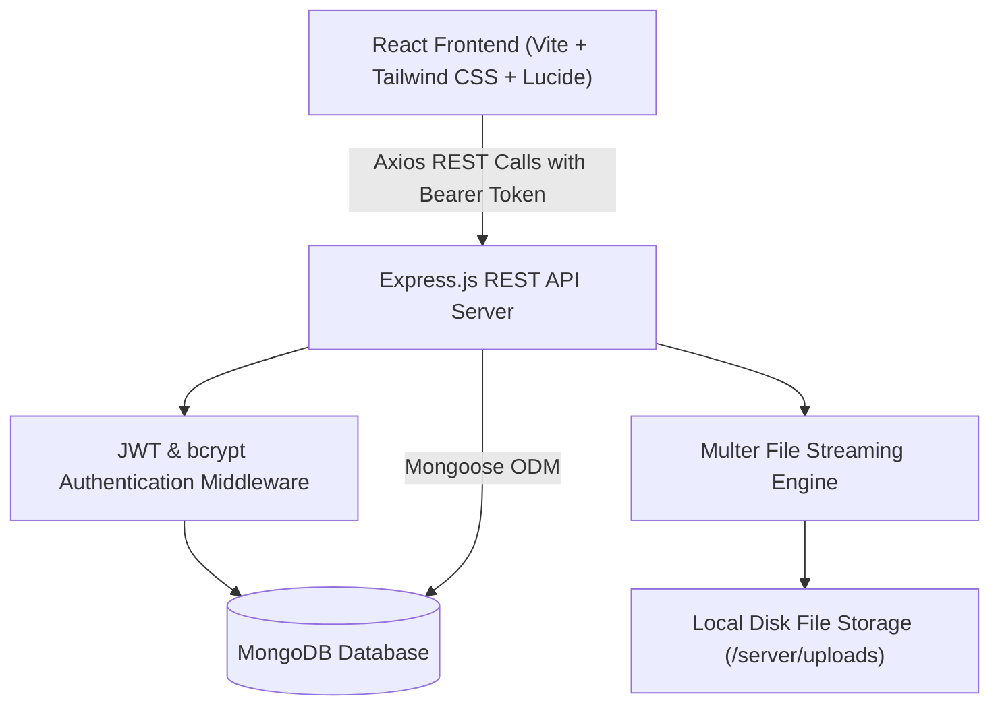

# ☁️ CloudNest | Cloud-Inspired File Management Application

> A full-stack, cloud-inspired web application (React, Node.js, Express.js, MongoDB) for storing, organizing, and sharing user files, covering comprehensive upload, download, and file-management workflows with authentication, authorization, and granular storage quota controls.

---

## 🌟 Highlights & Key Features

- **🛡️ Authentication & Authorization**:
  - Secure JSON Web Token (JWT) stateless auth with password encryption via `bcryptjs`.
  - Protected API routes enforcing owner-level data isolation.
  - **1-Click Demo Login** pre-loaded with realistic documents, code specifications, SVGs, and folders for immediate evaluation.

- **📁 Hierarchical Folder System**:
  - Infinite nesting support with recursive breadcrumb path navigation.
  - Custom color tags (Blue, Purple, Emerald, Amber, Rose, Slate, Indigo).
  - Folder item count badges and nested operations.

- **📤 File Management Workflows**:
  - Drag-and-drop multi-file upload dropzone with progress indicator.
  - Direct file download with original filename streaming.
  - In-app preview modal supporting **Images**, **PDFs**, **Code / Markdown / JSON (syntax reader with 1-click copy)**, **Audio**, and **Video**.
  - File operations: Rename, Move across folders, Star / Favorites, Soft Delete (Trash), Restore, and Permanent Purge.
  - Bulk actions: Multi-select files for batch Star, batch Trash, and batch Delete.

- **🔗 Cryptographic Link Sharing**:
  - Generate unique public share links (`/share/:token`) with optional expiration (24h, 7d, 30d, or permanent).
  - Public file view and direct download endpoints with download counter.
  - 1-click revoke link functionality.

- **📊 Storage Quotas & Insights**:
  - Real-time storage consumption calculation (500 MB default quota).
  - Multi-segmented visual meter and category breakdown (Images, Documents, Code, Media, Archives).
  - Live activity audit log tracking every user action (Upload, Delete, Restore, Star, Share).

- **🎨 Modern Cloud Drive Interface**:
  - Google Drive & Dropbox inspired UI with Grid and List view toggle.
  - Instant live search with regex filtering by file name.
  - Category filter pills (All, Images, Documents, Code, Videos, Archives).
  - Multi-criteria sorting (Modified date, Name A-Z, File size).

---

## 🏗️ System Architecture & Tech Stack



### Tech Stack:
- **Frontend**: React 18, Vite, Tailwind CSS, Lucide Icons, Axios, Canvas Confetti.
- **Backend**: Node.js, Express.js, Multer, JSON Web Tokens (JWT), bcryptjs, Morgan.
- **Database**: MongoDB & Mongoose ODM.
- **Storage**: Multi-part disk streaming with file sanitization and quota enforcement.

---

## 🗄️ MongoDB Data Models

### 1. User Model (`User.js`)
```javascript
{
  name: String,
  email: { type: String, unique: true },
  password: { type: String, select: false },
  storageUsed: { type: Number, default: 0 },       // Total bytes used
  storageLimit: { type: Number, default: 524288000 }, // 500 MB
  role: { type: String, default: 'user' },
  createdAt: Date
}
```

### 2. Folder Model (`Folder.js`)
```javascript
{
  name: String,
  user: { type: ObjectId, ref: 'User' },
  parent: { type: ObjectId, ref: 'Folder', default: null },
  color: { type: String, default: 'blue' },
  isStarred: { type: Boolean, default: false },
  isTrash: { type: Boolean, default: false },
  trashedAt: Date
}
```

### 3. File Model (`File.js`)
```javascript
{
  name: String,
  originalName: String,
  filename: String,                               // Unique disk filename
  user: { type: ObjectId, ref: 'User' },
  folder: { type: ObjectId, ref: 'Folder', default: null },
  size: Number,                                   // File size in bytes
  mimeType: String,
  category: ['image', 'document', 'audio', 'video', 'archive', 'code', 'other'],
  isStarred: { type: Boolean, default: false },
  isTrash: { type: Boolean, default: false },
  trashedAt: Date,
  isPublic: { type: Boolean, default: false },
  shareToken: String,
  shareExpires: Date,
  downloadCount: { type: Number, default: 0 }
}
```

### 4. Activity Model (`Activity.js`)
```javascript
{
  user: { type: ObjectId, ref: 'User' },
  action: ['upload', 'rename', 'move', 'delete', 'restore', 'star', 'share_created', 'share_revoked', 'download', 'create_folder'],
  targetType: ['file', 'folder'],
  targetName: String,
  targetId: ObjectId,
  details: Object,
  createdAt: Date
}
```

---

## 📡 API Endpoints Reference

### Authentication (`/api/auth`)
| Method | Endpoint | Description | Auth |
|---|---|---|---|
| `POST` | `/api/auth/register` | Register new user account | Public |
| `POST` | `/api/auth/login` | Authenticate & retrieve JWT token | Public |
| `POST` | `/api/auth/demo-login` | 1-Click instant login with pre-seeded demo data | Public |
| `GET` | `/api/auth/me` | Fetch logged-in user profile & live storage quota | Protected |
| `PUT` | `/api/auth/profile` | Update user profile / password | Protected |

### Folders (`/api/folders`)
| Method | Endpoint | Description | Auth |
|---|---|---|---|
| `GET` | `/api/folders` | List folders (query: `parent`, `trash`, `starred`, `all`) | Protected |
| `POST` | `/api/folders` | Create new folder with name and color tag | Protected |
| `GET` | `/api/folders/:id` | Get folder details and recursive breadcrumb trail | Protected |
| `PUT` | `/api/folders/:id` | Rename folder or change color | Protected |
| `PATCH` | `/api/folders/:id/star` | Toggle folder starred status | Protected |
| `DELETE` | `/api/folders/:id` | Move folder and nested items to trash | Protected |
| `PATCH` | `/api/folders/:id/restore` | Restore folder and nested items from trash | Protected |
| `DELETE` | `/api/folders/:id/permanent`| Permanently delete folder and clean disk files | Protected |

### Files (`/api/files`)
| Method | Endpoint | Description | Auth |
|---|---|---|---|
| `GET` | `/api/files` | Query files (`folder`, `category`, `starred`, `trash`, `search`, `sortBy`) | Protected |
| `POST` | `/api/files/upload` | Upload multiple files via `multipart/form-data` | Protected |
| `GET` | `/api/files/:id` | Get file metadata | Protected |
| `GET` | `/api/files/:id/download` | Stream / download file with original name | Protected |
| `GET` | `/api/files/:id/preview` | Stream file inline for in-app previewer | Protected |
| `PUT` | `/api/files/:id/rename` | Rename file display name | Protected |
| `PATCH` | `/api/files/:id/move` | Move file to another folder or root | Protected |
| `PATCH` | `/api/files/:id/star` | Toggle starred status | Protected |
| `DELETE` | `/api/files/:id` | Move file to trash | Protected |
| `PATCH` | `/api/files/:id/restore` | Restore file from trash | Protected |
| `DELETE` | `/api/files/:id/permanent`| Permanently delete file and reclaim quota | Protected |
| `POST` | `/api/files/bulk-trash` | Bulk move selected file IDs to trash | Protected |
| `POST` | `/api/files/bulk-delete` | Bulk permanently delete selected file IDs | Protected |

### Sharing (`/api/share`)
| Method | Endpoint | Description | Auth |
|---|---|---|---|
| `POST` | `/api/share/:fileId` | Generate public share link with optional expiration | Protected |
| `DELETE`| `/api/share/:fileId` | Revoke public share link | Protected |
| `GET` | `/api/share/my-shares` | List all files shared by current user | Protected |
| `GET` | `/api/share/view/:token` | Public file metadata for shared link | Public |
| `GET` | `/api/share/download/:token` | Public file download stream | Public |
| `GET` | `/api/share/preview/:token` | Public file preview stream | Public |

### Analytics (`/api/analytics`)
| Method | Endpoint | Description | Auth |
|---|---|---|---|
| `GET` | `/api/analytics/storage` | Aggregated storage usage & breakdown by category | Protected |
| `GET` | `/api/analytics/activity` | User activity timeline audit log | Protected |

---

## 🚀 Getting Started

### Prerequisites
- [Node.js](https://nodejs.org/) (v18+)
- [MongoDB](https://www.mongodb.com/) (running locally or MongoDB Atlas connection string)

### 1. Install Dependencies
```bash
# Install backend dependencies
cd server
npm install

# Install frontend dependencies
cd ../client
npm install
```

### 2. Environment Configuration
Verify `server/.env`:
```env
PORT=5000
MONGODB_URI=mongodb://127.0.0.1:27017/cloudnest
JWT_SECRET=cloudnest_super_secret_jwt_key_2026_secure
JWT_EXPIRE=30d
NODE_ENV=development
CLIENT_URL=http://localhost:5173
DEFAULT_STORAGE_LIMIT=524288000
```

### 3. Start the Application

In terminal 1 (start backend API):
```bash
cd server
npm start
```
*API runs at `http://localhost:5000`*

In terminal 2 (start React client):
```bash
cd client
npm run dev
```
*Frontend runs at `http://localhost:5173`*

### 4. Exploring the App
1. Open `http://localhost:5173` in your browser.
2. Click **"Explore with 1-Click Demo Account"** to immediately enter with sample folders, technical specs, SVGs, and markdown architecture documents pre-populated!
3. Alternatively, register a new user account with your own email and password.
